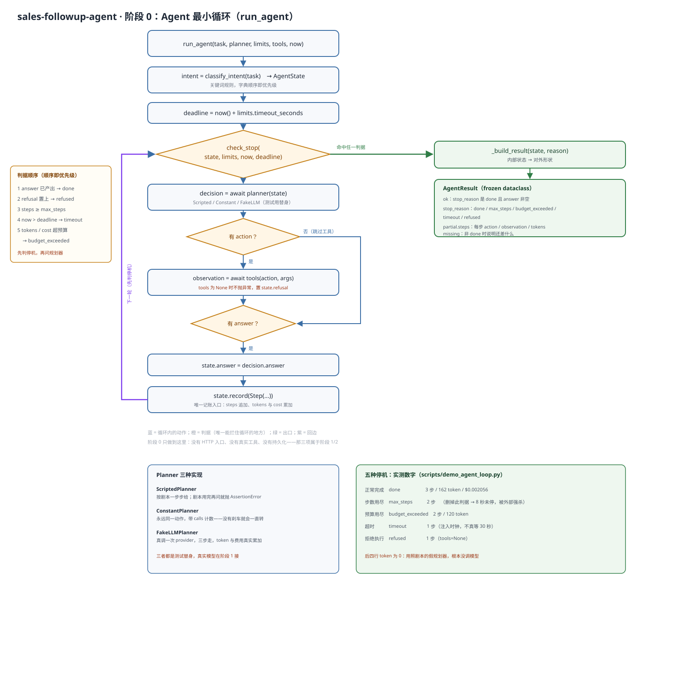
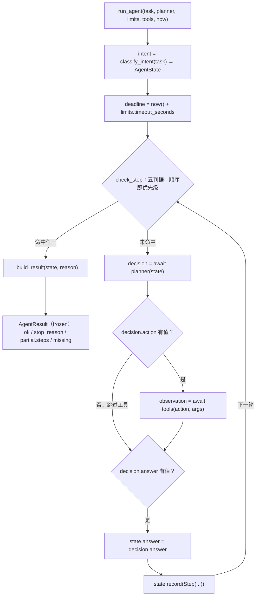

# 阶段 0：Agent 最小循环

`run_agent` 一个函数跑完「判停机 → 问规划器 → 执行工具 → 记账」四件事，不调模型、不判业务、不写库——三样都由外部注入。

图上蓝色是动作，橙色是判据（唯一能拦住循环的地方），绿色是出口，紫色是回边。



## 循环骨架



两条容易被忽略的规则：

- **停机判定在调用规划器之前**。所以 `max_steps=2` 时规划器一定只被调用两次，这一点有断言，不靠“大概不会多调”。
- **缺工具不抛异常**。`tools=None` 时置 `state.refusal`，下一轮按 `refused` 收尾——半成品加「还差什么」比 500 更有用。

## 五种停机条件

判据顺序就是优先级，先命中的先返回：

| 顺序 | 判据 | 触发条件 | stop_reason |
|---|---|---|---|
| 1 | answer 已产出 | `state.answer` 非空 | `done` |
| 2 | 被拒绝 | `state.refusal` 非空 | `refused` |
| 3 | 步数用尽 | `len(state.steps) >= max_steps` | `max_steps` |
| 4 | 超时 | `now > deadline` | `timeout` |
| 5 | 预算用尽 | `tokens` 或 `cost_usd` 超限 | `budget_exceeded` |

实测（`backend/scripts/demo_agent_loop.py`）：

| 场景 | stop_reason | 步数 | token | 费用 USD |
|---|---|---|---|---|
| 正常完成 | `done` | 3 | 162 | 0.002056 |
| 步数用尽 | `max_steps` | 2 | 0 | 0 |
| 预算用尽 | `budget_exceeded` | 2 | 120 | 0 |
| 超时 | `timeout` | 1 | 0 | 0 |
| 拒绝执行 | `refused` | 1 | 0 | 0 |

后四行 token 为 0，是因为用的是照剧本的假规划器，根本没调模型。

## 当前边界

阶段 0 只做到这里，下面三项都不在：

- **没有 HTTP 入口**：`run_agent` 目前只被单元测试和脚本调用，`POST /v1/chat` 走的是另一条单轮链路（模板 → 风控 → 网关 → provider）
- **没有真实工具**：`customer_profile` / `knowledge_search` 只是两个字符串，工具实现属于阶段 1；名字打错不会报错，只会静默返回「无数据」
- **没有持久化**：状态在内存里，进程退出即丢；checkpointer 属于阶段 2

## 怎么复现

```bash
cd backend
.venv/bin/python scripts/demo_agent_loop.py
```
